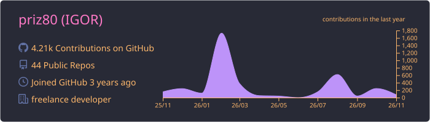
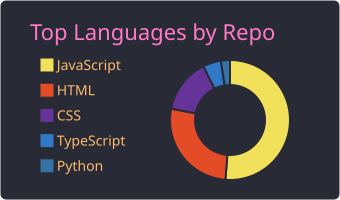
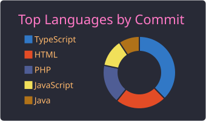
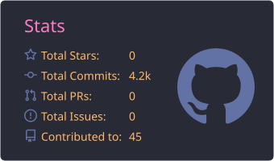
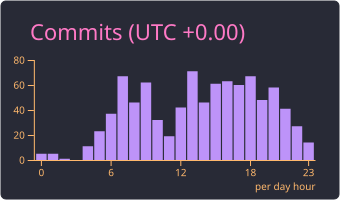

  
  

# Fullstack Developer

---

## 📊 GitHub Statistics

  <!-- 0. General info and contribution graph -->
  
    
  <!-- 1. Repositories per language -->
  
    
  <!-- 2. Most commit language -->
  
    
  <!-- 3. General stats -->
  
    
  <!-- 4. Productive time -->
  

---

## 📬 Contacts

- **Email:** [priz8090@gmail.com](mailto:priz8090@gmail.com)
- **Telegram:** [@Igor_chernenko](https://t.me/Igor_chernenko)

---

## 🛠 Key Skills

- **Frontend:** JavaScript, React, HTML5, CSS3, BEM, Flexbox, SVG Sprites, Responsive Web Design, Pixel Perfect
- **Backend:** PHP, Python, Node.js
- **Databases:** SQL, DBeaver
- **DevOps & Servers:** Docker, Nginx, Apache, VPS, Linux/Ubuntu, CI/CD, GitHub Actions
- **Tools:** Webpack, npm, Git, Bash, SSH, Postman, Figma
- **AI Tools:** GigaCode, MCP (Model Context Protocol)

---

## 💼 Work Experience

**Fullstack Developer (Freelance / Self-Employed)**  
*April 2023 — Present (3 years 7 months)*

### Responsibilities:
- Designing architecture and developing full-cycle web applications from concept to production
- **Frontend:** Building interactive UIs with React, responsive layout using BEM methodology, Pixel Perfect implementation from Figma designs
- **Backend:** Developing server-side logic and APIs using PHP, Node.js, and Python
- **DevOps:** Configuring and administrating VPS/Linux servers, setting up Nginx and Apache, containerization with Docker
- **CI/CD:** Automating testing and deployment workflows via GitHub Actions
- **Databases:** Designing database schemas, writing SQL queries, managing data with DBeaver
- **Project Management:** Communicating with clients, gathering requirements, writing technical specifications, backlog management (Kanban/Agile)

### Achievements:
- ✅ Successfully delivered and launched **4+ full-cycle commercial projects** for private clients and businesses
- ⚡ Integrated AI tools (GigaCode, MCP) into daily development workflows, accelerating coding and refactoring by **30%**
- 🚀 Configured automated deployment pipelines for client websites, reducing production release time to **a few minutes**
- ✅ Achieved **100% W3C code validity** across all delivered projects, improving baseline SEO performance

---

## 🤝 Soft Skills

- **Self-Organization** — independent management of remote workflows, strict control of deadlines and project scope
- **Agile & Kanban** — hands-on experience with task boards, backlog grooming, conducting client calls and demos
- **Attention to Detail** — high perseverance, stress resistance, fast learner of new technologies

---

## 🌐 Languages

- **Russian** — Native
- **English** — B2 (Upper-Intermediate)
