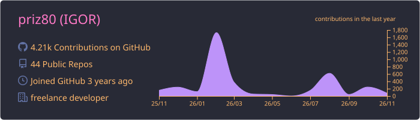
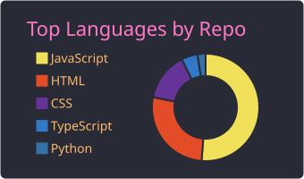
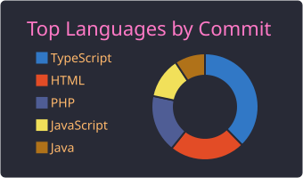
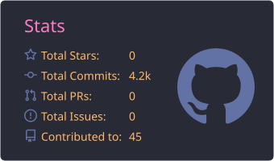
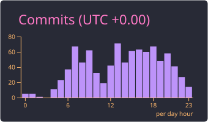

  
  

# Fullstack Developer

---

## 📊 Статистика GitHub

  <!-- 0. Общая информация и график контрибьюций за год -->
  
    
  <!-- 1. Соотношение репозиториев по языкам -->
  
    
  <!-- 2. Топ языков по количеству коммитов -->
  
    
  <!-- 3. Общая статистика (звезды, коммиты, PR, issues) -->
  
    
  <!-- 4. Продуктивное время суток (когда вы чаще всего коммитите) -->
  

---

## 📬 Контакты

- **Email:** [priz8090@gmail.com](mailto:priz8090@gmail.com)
- **Telegram:** [@Igor_chernenko](https://t.me/Igor_chernenko)

---

## 🛠 Ключевые навыки

- **Frontend:** JavaScript, React, HTML5, CSS3, БЭМ, Flexbox, SVG-спрайты, Адаптивная верстка, Pixel Perfect
- **Backend:** PHP, Python, Node.js
- **Базы данных:** SQL, DBeaver
- **DevOps & Серверы:** Docker, Nginx, Apache, VPS, Linux/Ubuntu, CI/CD, GitHub Actions
- **Инструменты:** Webpack, npm, Git, Bash, SSH, Postman, Figma
- **AI Tools:** GigaCode, MCP (Model Context Protocol)

---

## 💼 Опыт работы

**Fullstack-разработчик (Фриланс / Самозанятость)**  
*Апрель 2023 — по настоящее время (3 года 7 месяцев)*

### Обязанности:
- Проектирование архитектуры и разработка веб-приложений полного цикла от идеи до продакшена
- **Frontend:** Создание интерактивных интерфейсов на React, адаптивная вёрстка по методологии БЭМ, Pixel Perfect по макетам из Figma
- **Backend:** Разработка серверной логики и API на PHP, Node.js, Python
- **DevOps:** Настройка и администрирование VPS/Linux, конфигурация Nginx и Apache, контейнеризация в Docker
- **CI/CD:** Автоматизация процессов тестирования и деплоя через GitHub Actions
- **Базы данных:** Проектирование схем, написание SQL-запросов, управление данными через DBeaver
- **Управление проектами:** Ведение переговоров с клиентами, сбор требований, составление ТЗ, управление бэклогом (Kanban/Agile)

### Достижения:
- ✅ Успешно реализовал и запустил **4+ коммерческих проектов** полного цикла для частных клиентов и бизнеса
- ⚡ Внедрил ИИ-инструменты (GigaCode, MCP) в ежедневную разработку, ускорив написание и рефакторинг кода на **30%**
- 🚀 Настроил автоматический деплоймент для клиентских сайтов, сократив время передачи готового продукта в продакшен до **нескольких минут**
- ✅ Обеспечил **100% валидность** кода по стандартам W3C во всех сданных проектах, улучшив базовое SEO-продвижение

---

## 🤝 Личные качества

- **Самоорганизация** — самостоятельное управление удалённым рабочим процессом, контроль дедлайнов и объёма задач
- **Agile & Kanban** — опыт работы с досками задач, ведение бэклога, проведение созвонов и презентаций для клиентов
- **Внимание к деталям** — высокая усидчивость, стрессоустойчивость, быстрое обучение новым технологиям

---

## 🌐 Языки

- **Русский** — родной
- **Английский** — B2 (Upper-Intermediate)
